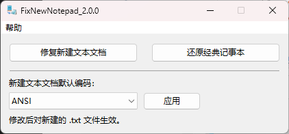

<div align="center">

<h1>FixNewNotepad</h1>

> 专为解决 Windows 11 系统中右键菜单“新建文本文档”丢失的问题，且支持还原经典记事本。


</div>

## 📸 工具演示

| 主程序 |
| --- |
|  |

## ⬇️ 下载发行版

[](https://github.com/NeetheCheeBao/FixNewNotepad/releases)

## 🔧 本地构建

1. 克隆仓库

```bash
git clone https://github.com/NeetheCheeBao/FixNewNotepad.git
```

```bash
gh repo clone NeetheCheeBao/FixNewNotepad
```

2. 一键编译

```bash
.\build.bat
```

## 📂 项目结构

```text
FixNewNotepad
|   .gitignore
|   build.bat               # 一键编译脚本
|   build.rs                # 构建脚本：嵌入图标与清单、注入版本号
|   Cargo.lock              # 依赖版本锁定文件
|   Cargo.toml              # 项目元信息与依赖配置
|   LICENSE
|   README.md
|   version.ini             # 版本号配置
|
+---assets
|       icon.ico            # 图标
|
+---screenshot
|       demo1.png           # 截图
|
\---src
        fix.rs              # 注册表修复逻辑（新建菜单 / 关联 / 编码）
        main.rs             # 程序入口：窗口、菜单与控件
        win.rs              # Win32 辅助函数（宽字符、DPI、系统字体）
```

## ⚖️ 许可证

本项目采用 GNU General Public License v3.0 许可证 - 详情请参阅 [LICENSE](LICENSE) 文件